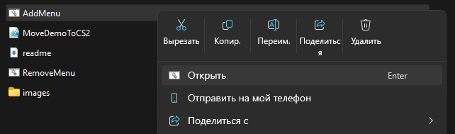
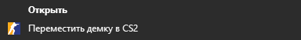
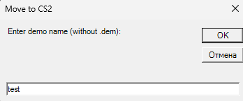
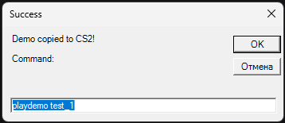
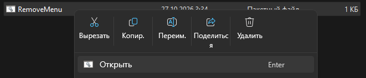

# Faceit CS2 Demo Mover

Скрипт для Windows, который добавляет в контекстное меню проводника пункт "Переместить демку в CS2". Он автоматически распаковывает скачанный архив с Faceit, переименовывает файл и копирует его в нужную папку игры.

## Особенности
- Автоматически находит папку `game\csgo` в Counter-Strike 2 через реестр Steam.
- Распаковывает архивы `.zst`, `.gz`, `.zip`, `.rar`, `.7z` с помощью 7-Zip.
- Не удаляет исходный архив из папки "Загрузки", он остается на месте.
- Позволяет задать любое имя для демки перед копированием.
- Показывает готовую команду `playdemo` для вставки в консоль игры.
- Автоматически определяет язык системы и подставляет нужный текст в меню.

## Требования
- Windows 10 или 11.
- Установленный 7-Zip (скачать можно с официального сайта 7-zip.org).
- Установленный Steam и Counter-Strike 2.

## Установка

1. Скачайте все файлы из этого репозитория в одну папку.
2. Найдите файл `AddMenu.bat` и запустите его.
3. Появится запрос от системы контроля учетных записей UAC. Нажмите "Да".
4. Скрипт пропишет меню в реестр. 

Важно: в Windows 11 новый пункт находится в подменю "Показать дополнительные параметры", так как Microsoft скрывает сторонние расширения в основном меню.

## Использование

1. Скачайте демку с Faceit (файл с расширением `.zst`).
2. Нажмите на него правой кнопкой мыши.
3. Выберите "Показать дополнительные параметры".

4. Нажмите "Переместить демку в CS2".
5. Введите желаемое название без расширения `.dem`.

6. Скрипт скопирует файл в CS2 и покажет команду. Введите её в консоли игры.

## Удаление

Если нужно убрать пункт из контекстного меню:

1. Запустите файл `RemoveMenu.bat`.
2. Нажмите "Да" в окне UAC.
3. Меню будет удалено.

---

# Faceit CS2 Demo Mover (English)

A Windows script that adds a "Move demo to CS2" option to the Explorer context menu. It automatically extracts the downloaded archive from Faceit, renames the file, and copies it to the correct game folder.

## Features
- Automatically locates the `game\csgo` folder in Counter-Strike 2 via the Steam registry.
- Extracts `.zst`, `.gz`, `.zip`, `.rar`, `.7z` archives using 7-Zip.
- Does not delete the source archive from the Downloads folder; it stays where it is.
- Allows you to set a custom name for the demo before copying.
- Shows a ready-to-use `playdemo` command to paste into the game console.
- Automatically detects the system language and uses the appropriate text in the menu.

## Requirements
- Windows 10 or 11.
- Installed 7-Zip (can be downloaded from the official site 7-zip.org).
- Installed Steam and Counter-Strike 2.

## Installation

1. Download all files from this repository into a single folder.
2. Find the `AddMenu.bat` file and run it.
3. A User Account Control UAC prompt will appear. Click "Yes".
4. The script will register the menu in the Windows registry.

Note: In Windows 11, the new item is located in the "Show more options" submenu, as Microsoft hides third-party extensions in the main menu.

## Usage

1. Download a demo from Faceit (a file with the `.zst` extension).
2. Right-click on it.
3. Select "Show more options".

4. Click "Move demo to CS2".
5. Enter the desired name without the `.dem` extension.

6. The script will copy the file to CS2 and show a command. Enter it in the game console.

## Uninstallation

If you need to remove the item from the context menu:

1. Run the `RemoveMenu.bat` file.
2. Click "Yes" in the UAC window.
3. The menu will be removed.

